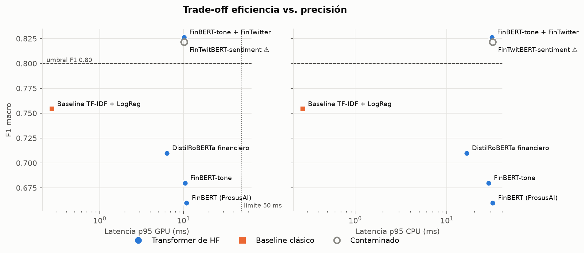

# Análisis de sentimiento financiero con modelos preentrenados de Hugging Face

Prototipo que **selecciona, implementa y compara modelos preentrenados de Hugging Face** para
clasificar tweets de noticias financieras como **Bearish**, **Bullish** o **Neutral** y emitir alertas
tempranas de mercado. Rama de IA: procesamiento de lenguaje natural (clasificación de texto).

**Resultado:** el modelo recomendado es
[`nickmuchi/finbert-tone-finetuned-fintwitter-classification`](https://huggingface.co/nickmuchi/finbert-tone-finetuned-fintwitter-classification),
el único candidato confiable que cumple los cuatro umbrales de negocio.

---

## Estructura del repositorio

```
sentimiento-financiero-hf/
├── data/          # Dataset en CSV y Excel, metadatos y descripción (data/README.md)
├── notebooks/     # Cuaderno principal, ejecutado (Colab / Jupyter)
├── results/       # Tablas CSV, predicciones, gráficas y metadatos de la ejecución
├── src/           # Código reutilizable 
├── requirements.txt
└── .env.example   # Plantilla para el token de Hugging Face
```

| Script (`src/`) | Función |
|---|---|
| `download_dataset.py` | Descarga el dataset (revisión fijada) y lo exporta a `data/` en CSV y Excel |

---

## Entorno de ejecución

El código detecta el hardware y usa el mejor acelerador disponible: **CUDA** (Google Colab, GPU T4,
fp16), luego **MPS** (Apple Silicon, fp32) y, como respaldo, **CPU**. Para forzar uno, usa
`FORCE_DEVICE=cpu` o `--device cpu`.

| Ejecución de referencia | |
|---|---|
| Equipo | Mac Studio, Apple M1 Max, 32 GB (GPU vía MPS) |
| Software | Python 3.13 · torch 2.14 · transformers 5.19 · datasets 5.1 · evaluate 0.4.6 · scikit-learn 1.9 |
| Duración | ≈ 1.5 min con los modelos en caché (la primera descarga es de ≈ 1.9 GB) |

Las métricas de calidad son deterministas; las latencias varían según el hardware y la ejecución.

---

## Pasos de ejecución

### 1. Token de Hugging Face (mínimo privilegio)

En [huggingface.co/settings/tokens](https://huggingface.co/settings/tokens) elige **Create new token →
Fine-grained** y marca **solo** *Read access to contents of all public gated repos you can access*.

### 2a. Local

```bash
git clone <URL-del-repositorio> sentimiento-financiero-hf && cd sentimiento-financiero-hf
python3.13 -m venv .venv && source .venv/bin/activate   # Python 3.10–3.14
pip install -r requirements.txt                          # GPU NVIDIA: instala antes torch con CUDA
cp .env.example .env                                     # y coloca tu token en HF_TOKEN

python src/download_dataset.py                           # dataset → data/
jupyter nbconvert --to notebook --execute --inplace notebooks/sentimiento_financiero_hf.ipynb
# alternativa sin notebook:  python src/run_benchmark.py [--device cpu]
python src/build_report.py --force                       # opcional: regenera el Word (sobrescribe ediciones manuales)
```

### 2b. Google Colab

1. **Archivo → Subir cuaderno** → `notebooks/sentimiento_financiero_hf.ipynb`.
2. **Entorno de ejecución → Cambiar tipo de entorno de ejecución → GPU T4**.
3. En  **Secrets**, agrega `HF_TOKEN` y activa *Notebook access*.
4. **Ejecutar todas.** Si Colab pide reiniciar después de instalar, reinicia y vuelve a ejecutar.

### Reproducibilidad

El dataset y los modelos se descargan **por commit del Hub**, con **semilla fija (42)**. Las métricas
de `evaluate` se verifican contra scikit-learn, y el hardware y las versiones de cada ejecución
quedan en `results/run_metadata.json`.

## Resultados

| Modelo | Accuracy | F1 macro | Recall Bearish | p95 GPU | Veredicto |
|---|---|---|---|---|---|
| **FinBERT-tone + FinTwitter** | **0.867** | **0.826** | **0.821** | ≈ 10 ms | **Recomendado** |
| FinTwitBERT | 0.856 | 0.821 | 0.916 | ≈ 10 ms | Descartado: entrenó con el conjunto de evaluación |
| Baseline TF-IDF + LogReg | 0.812 | 0.754 | 0.718 | < 1 ms (CPU) | No cumple los umbrales |
| DistilRoBERTa financiero | 0.755 | 0.710 | 0.772 | ≈ 6 ms | No cumple los umbrales |
| FinBERT-tone | 0.741 | 0.680 | 0.648 | ≈ 10 ms | No cumple los umbrales |
| FinBERT (ProsusAI) | 0.716 | 0.660 | 0.752 | ≈ 10 ms | No cumple los umbrales |

Umbrales: accuracy ≥ 0.85 · F1 macro ≥ 0.80 · recall Bearish ≥ 0.80 · p95 ≤ 50 ms. El detalle
(tamaño, licencia, latencia en CPU y recursos) está en `results/model_comparison.csv` y en el reporte.



---

## Seguridad del token

El token **nunca** está en el código: se lee de los Secrets de Colab o de un `.env` local, que está en
`.gitignore`. Solo se expone al proceso en ejecución, sin escribirse en disco. Para revocarlo, ve a
[huggingface.co/settings/tokens](https://huggingface.co/settings/tokens) → *Invalidate*.
